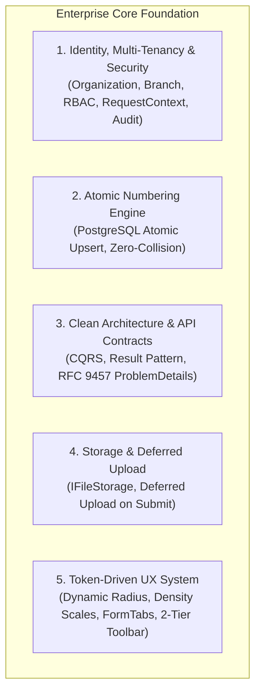

# Enterprise Core Scaffolding & Foundation Architecture

## 🎯 1. Overview & Core Philosophy

คู่มือฉบับนี้กำหนดมาตรฐานสถาปัตยกรรมระดับ **Enterprise Application Foundation** สำหรับใช้ในการตั้งต้นโปรเจกต์ระบบบริหารจัดการธุรกิจใหม่ (เช่น ระบบจัดการห้องพัก/หอพัก, ระบบคลินิก, ระบบคลังสินค้า, ระบบจัดการโครงการ) โดยใช้แนวคิด:

1. **Clean-Slate with Cherry-picked Foundation:** เริ่มต้นโปรเจกต์ใหม่ใน Git Repository ที่สะอาด 100% แต่ยกแกนหลักทางสถาปัตยกรรม (Core Engines & UI Systems) มาใช้งาน เพื่อประหยัดเวลาพัฒนาลงได้ 60–70% โดยไม่ต้องแบกรับโค้ดขยะหรือโมดูลเฉพาะทางเก่า
2. **Domain-Agnostic Core:** โครงสร้างพื้นฐานทั้งหมดต้องเป็นกลาง ไม่ผูกติดกับตรรกะธุรกิจใดธุรกิจหนึ่ง (แยก Domain-Specific ออกจาก Core อย่างเด็ดขาด)
3. **Token-Driven Theming (No Hardcoded Styles):** การออกแบบหน้าจอต้องขับเคลื่อนผ่าน **Semantic Tokens** ทั้งระบบ ห้าม Hardcode สี รัศมีมุม (`border-radius`) หรือความสูงของช่องกรอก โดยกำหนดผ่าน `theme.config.json` และ CSS Variables
4. **AI-Native Governance (First-Class Agent Space):** เตรียมพื้นที่สำหรับการทำงานร่วมกับ AI Agent อย่างเป็นระบบ (`AGENTS.md`, `CONTEXT.md`, `design.md`, `.agents/skills/`) เพื่อคุมคุณภาพและความถูกต้องของโค้ดให้สม่ำเสมอ

---

## 🏛️ 2. The 5 Pillars of Enterprise Core



### เสาหลักที่ 1: Identity, Multi-Tenancy & Security
* **Multi-Tenancy Hierarchy:** รองรับโครงสร้างองค์กรแบบ `Organization` (นิติบุคคลหลัก) $\rightarrow$ `Branch` (สาขา/อาคาร/หน่วยงาน) เป็น First-class citizen
* **Global Query Filters:** ผูก `OrganizationId` และ `BranchId` เข้ากับ Global Query Filter ของ ORM เพื่อป้องกันข้อมูลรั่วไหลข้ามสาขาโดยอัตโนมัติ
* **`RequestContext` Scoped Service:** ดักจับทุก Request ผ่าน Middleware เพื่อสกัด `UserId`, `OrganizationId`, `BranchId`, `Permissions`, `CorrelationId` ไว้ใน Scoped Service กลาง
* **Automatic Audit Trail & Soft Delete:** ทุก Entity สืบทอดจาก `AuditableEntity` (บันทึก `CreatedAt`, `CreatedBy`, `UpdatedAt`, `UpdatedBy`) และ `SoftDeletableEntity` (`IsDeleted`, `DeletedAt`) ผ่าน Database Interceptor

### เสาหลักที่ 2: Atomic Upsert Document Numbering Engine
* **Zero-Collision Concurrency:** ระบบสร้างเลขที่เอกสาร (สัญญา, ใบแจ้งหนี้, ใบเสร็จ, รหัสรายการ) ต้องใช้ **PostgreSQL Atomic UPSERT** (`INSERT ... ON CONFLICT DO UPDATE`) เพื่อรับประกันการทำงานแบบ Concurrency สูงสุด ปราศจากปัญหาเลขซ้ำหรือช่องว่าง (Zero Collision / Gapless Sequence)
* **Token Syntax:** รองรับรูปแบบยืดหยุ่น เช่น `{BRANCH}-{TYPE}-{YEAR:YY}{MONTH:MM}-{SEQ:4}` $\rightarrow$ `BKK-INV-2610-0001`
* **Multi-Branch Isolation:** แยกนับเลขลำดับอิสระตามสาขา ประเภทเอกสาร และรอบการรีเซ็ต (เช่น รายเดือน, รายปี, หรือรันต่อเนื่อง)

### เสาหลักที่ 3: Backend Architecture & API Standards
* **Clean Architecture 4 ชั้น:**
  * `Domain`: Pure Business Logic, Entities, Enums, Value Objects (ปราศจาก External Dependencies)
  * `Application`: CQRS Handlers (MediatR), Validators (FluentValidation), DTOs, Business Rules
  * `Infrastructure`: EF Core, PostgreSQL Configurations, External APIs, File Storage, Clock
  * `Api`: Controllers / Minimal APIs, Middlewares, Filters, OpenAPI Swagger
* **RFC 9457 Problem Details & Result Pattern:**
  * ห้ามใช้ Exception พร่ำเพรื่อในการคุม Normal Flow ให้ใช้ `Result<T>` ใน Application Layer
  * ส่ง Error ผ่านมาตรฐาน RFC 9457 `ProblemDetails` พร้อม Error Code ชัดเจน (เช่น `ERR_ENTITY_NOT_FOUND`) รองรับการแปลงภาษา i18n
* **Deterministic Pagination & Filtering:**
  * รองรับทั้ง Cursor/Keyset สำหรับตารางขนาดใหญ่ และ Offset สำหรับตารางทั่วไป
  * พารามิเตอร์มาตรฐาน: `page`, `pageSize`, `search`, `sortBy`, `sortDirection`, `filters`

### เสาหลักที่ 4: Storage & Deferred File Upload
* **Deferred Upload Pattern:** ห้ามยิง API อัปโหลดไฟล์ขึ้นเซิร์ฟเวอร์ทันทีที่ผู้ใช้เลือกไฟล์ในหน้าฟอร์ม ให้สร้าง Preview ชั่วคราวใน Memory/Blob และส่งไปอัปโหลดจริงในฟังก์ชัน `onSubmit` เท่านั้น เพื่อป้องกันขยะไฟล์ค้างในระบบเมื่อผู้ใช้กดยกเลิก
* **Storage Provider Abstraction (`IFileStorageService`):** ออกแบบ Interface กลางที่สลับการใช้งานระหว่าง Local File System, AWS S3, Cloudflare R2, หรือ Google Cloud Storage ได้อย่างอิสระ

### เสาหลักที่ 5: Token-Driven Frontend & ERP UX System
* **No Hardcoded Style Values:** ห้ามเขียนค่าสี Hex (เช่น `#0B3056`) หรือ `border-radius: 0px / 8px` ลงใน Component โดยตรง ต้องเรียกผ่าน Semantic Tokens (`var(--radius)`, `var(--primary)`, `bg-primary`)
* **Strict Density Scales & Input Height Harmony:**
  * `compact`: $36\text{px}$ (`h-9` / `--control-height-compact`) สำหรับหน้าตารางข้อมูลและงานบริหารความหนาแน่นสูง
  * `comfortable`: $40\text{px}$ (`h-10` / `--control-height-comfortable`) สำหรับหน้าฟอร์มทั่วไป
  * `spacious`: $44\text{px}$ (`h-11` / `--control-height-spacious`) สำหรับงานระดับ Touch Target หรือสไตล์สถาปัตย์คมกริบ
  * **กฎเหล็ก:** ช่องกรอก Select และปุ่ม Action ในระดับกริดเดียวกัน ต้องใช้ Density เดียวกันเสมอ ห้ามเหลื่อม
* **2-Tier Architectural Filter Toolbar:**
  * Tier 1: แถวค้นหาหลัก (`ListSearchInput`) + ปุ่ม Action ชิดขวา
  * Tier 2: กริดตัวกรอง 4 คอลัมน์สม่ำเสมอ (`grid-cols-1 sm:grid-cols-2 lg:grid-cols-4`) + ชิปสรุปตัวกรอง (`ActiveFilterChips`)
* **Tabbed Form Architecture (`FormTabs` + Red Dot Error):**
  * ฟอร์มที่มีข้อมูลหลายส่วนต้องใช้แท็บพร้อม **จุดสีแดง (Red Dot)** เตือนบนหัวแท็บที่ Validation ไม่ผ่าน และกระโดดไปแท็บแรกที่มี Error อัตโนมัติเมื่อกดบันทึก
* **URL State Synchronization (`useListState`):**
  * ค้นหา, กรอง, จัดเรียง และเลขหน้า ต้อง Sync เข้า URL Query Parameters เสมอ

---

## 🤖 3. AI Agent Governance & Context Architecture

ทุกโปรเจกต์ที่สร้างขึ้นใหม่ต้องมีระบบ **AI Agent Governance** บรรจุอยู่ตั้งแต่ Commit แรก:

```text
my-project/
├── AGENTS.md                  # กฎเหล็กหลักของโปรเจกต์ (Global Single Source of Truth)
├── CONTEXT.md                 # พจนานุกรมศัพท์ธุรกิจ (Ubiquitous Language)
├── design.md                  # มาตรฐาน Design System และ Token Reference
├── .agents/                   # พื้นที่เก็บ Skills และ Rules ของโปรเจกต์
│   ├── skills/                # คู่มือวิชาชีพเฉพาะโปรเจกต์ (API, Forms, Lists, Numbering)
│   └── AGENTS.md              # สำเนากฎเสริม
├── backend/AGENTS.md          # กฎเฉพาะด้าน Clean Architecture & Data Safety
└── frontend/AGENTS.md         # กฎเฉพาะด้าน UI, Tokens, i18n & Form UX
```

### หน้าที่ของแต่ละไฟล์:
1. **`AGENTS.md` (Root):** กำหนดขอบเขตงาน (Minimal Blast Radius), กฎห้ามใช้ `any`/`as any`/`@ts-ignore`, การบังคับใช้ i18n สองภาษา, และคำสั่ง Verify
2. **`CONTEXT.md`:** นิยามคำศัพท์ทางธุรกิจ (Domain Terminology) เพื่อให้ทั้งโปรแกรมเมอร์และ AI ใช้คำเดียวกัน เช่น ห้ามเรียกปนกันระหว่าง `Room` vs `Unit` หรือ `Tenant` vs `Customer`
3. **`design.md`:** ระบุรายละเอียด Semantic Design Tokens, Breakpoint, ระบบสี, และมาตรฐานฟอร์ม/ตาราง
4. **`.agents/skills/`:** คู่มือขั้นตอนการสร้าง Feature ใหม่ เช่น `building-business-apis`, `building-business-forms`

---

## 📁 4. Production-Grade Directory Template

```text
enterprise-starter-core/
│
├── .agents/                               # 🤖 AI Agent Governance Space
│   ├── skills/
│   │   ├── building-business-apis/        # คู่มือสร้าง API: CQRS, RFC 9457, Pagination
│   │   │   └── SKILL.md
│   │   ├── building-business-forms/       # คู่มือสร้างฟอร์ม: FormTabs, Input Harmony, Deferred Upload
│   │   │   └── SKILL.md
│   │   ├── building-business-lists/       # คู่มือสร้างตาราง: 2-Tier Filter, useListState, Data Table
│   │   │   └── SKILL.md
│   │   └── business-document-numbering/   # คู่มือสร้างระบบรันเลขที่เอกสาร Zero-Collision
│   │       └── SKILL.md
│   └── AGENTS.md
│
├── AGENTS.md                              # 📜 กฎเหล็กหลักของโปรเจกต์
├── CONTEXT.md                             # 📖 พจนานุกรมคำศัพท์ธุรกิจ
├── design.md                              # 🎨 มาตรฐานการออกแบบและ Design Tokens
├── Makefile                               # ⚙️ คำสั่งกลาง (make build, make test, make dev)
├── README.md                              # 📘 เอกสารเริ่มต้นสำหรับ Developer
│
├── design-tokens/                         # 🎨 แหล่งความจริงเดียวของดีไซน์ (W3C DTCG Format)
│   ├── primitive/                         # ค่าดิบ: สี, ขนาดสเกล
│   ├── semantic/                          # ความหมาย: color.action.primary, radius.control, size.control.height
│   ├── themes/                            # Dark mode, Compact mode overrides
│   └── style-dictionary.config.mjs        # ตัวคอมไพล์ Token สู่ CSS และ Dart
│
├── docs/                                  # 📚 เอกสารสถาปัตยกรรมและการตัดสินใจ
│   ├── 00-overview/
│   ├── adr/                               # Architectural Decision Records
│   │   ├── 0001-clean-architecture.md
│   │   ├── 0002-zero-collision-numbering.md
│   │   └── 0003-token-driven-theming.md
│   └── specs/
│
├── backend/                               # 🏢 Backend (.NET 10 Clean Architecture)
│   ├── AGENTS.md
│   ├── Directory.Build.props              # Strict Compiler & Nullable Warnings
│   ├── Directory.Packages.props           # Central Package Management (CPM)
│   ├── StarterApp.slnx                    # Solution file
│   │
│   ├── src/
│   │   ├── Core.Domain/                   # 💎 Pure Domain
│   │   │   ├── Common/                    # BaseEntity, AuditableEntity, ValueObject, IAggregateRoot
│   │   │   ├── Enums/                     # DocumentType, ResetPeriod, Status
│   │   │   └── Exceptions/                # DomainException
│   │   │
│   │   ├── Core.Application/              # ⚙️ Application Use Cases (CQRS)
│   │   │   ├── Common/                    # IRequestContext, Result<T>, PagedList
│   │   │   │   ├── Behaviors/             # ValidationBehavior, PerformanceBehavior, LoggingBehavior
│   │   │   │   ├── Interfaces/            # IAppDbContext, IFileStorageService, IDateTimeProvider
│   │   │   │   └── Models/                # ProblemDetails, ErrorCode
│   │   │   └── Slices/                    # Vertical Slices (Core Engines)
│   │   │       └── DocumentNumbering/     # Generic Numbering Engine
│   │   │
│   │   ├── Infrastructure/                # 🔌 External Implementations
│   │   │   ├── Persistence/               # EF Core, PostgreSQL, Interceptors, Migrations
│   │   │   │   ├── Interceptors/          # AuditableEntityInterceptor, SoftDeleteInterceptor
│   │   │   │   └── Sequences/             # Atomic Upsert Sequence Counter
│   │   │   ├── Identity/                  # JWT Provider, CurrentUserService, PasswordHasher
│   │   │   └── Storage/                   # LocalDisk / S3 / R2 Storage Service
│   │   │
│   │   └── Api/                           # 🚀 Host & Endpoints
│   │       ├── Controllers/               # BaseApiController
│   │       ├── Middlewares/               # RequestContextMiddleware, ExceptionHandlingMiddleware
│   │       ├── Program.cs
│   │       └── appsettings.json
│   │
│   └── tests/                             # 🧪 Automated Tests
│       ├── Architecture.Tests/            # NetArchTest (ตรวจห้าม Layer ละเมิด Dependency)
│       ├── Application.UnitTests/         # Handlers & Business Logic Tests
│       └── Api.IntegrationTests/          # Testcontainers PostgreSQL Tests
│
├── frontend/                              # 💻 Frontend (Next.js App Router)
│   ├── AGENTS.md
│   ├── package.json
│   ├── tailwind.config.ts                 # ผูกคลาสเข้ากับ CSS Variables ของ Token
│   │
│   └── src/
│       ├── app/                           # App Router
│       │   ├── [locale]/                  # i18n Root Layout
│       │   │   ├── layout.tsx             # Root Layout & Theme Providers
│       │   │   └── (dashboard)/           # Protected Area
│       │   │       └── layout.tsx         # Sidebar, Header, Breadcrumbs
│       │   └── api/
│       │
│       ├── components/                    # 🧩 UI Components กลาง
│       │   ├── ui/                        # Button, Input, Select, Modal, Drawer, Tooltip
│       │   ├── table/                     # DataTable, TablePagination, TableEmptyState
│       │   ├── list/                      # ListToolbar (2-Tier), ListSearchInput, ActiveFilterChips
│       │   └── forms/                     # FormTabs (Red Dot Error), FormRow, MultiLangInput
│       │
│       ├── hooks/                         # 🪝 Reusable Hooks
│       │   ├── useListState.ts            # Sync ตารางและตัวกรองเข้า URL
│       │   ├── useDeferredFileUpload.ts   # จัดการคิวไฟล์และอัปโหลดตอนกด Submit
│       │   ├── useFormTabErrors.ts        # สแกน Error ในแท็บฟอร์ม
│       │   └── useConfirmationModal.ts    # Trigger Modal ยืนยันคำสั่งเสี่ยง
│       │
│       ├── lib/                           # 🛠️ Utility Functions
│       │   ├── apiClient.ts               # Axios/Fetch + RFC 9457 Error Interceptor
│       │   └── utils.ts                   # cn(), formatters (วันที่, สกุลเงิน)
│       │
│       ├── messages/                      # 🌐 ระบบแปลภาษา (i18n)
│       │   ├── th.json                    # ภาษาไทย (Default)
│       │   └── en.json                    # ภาษาอังกฤษ (Required Pair)
│       │
│       └── styles/
│           ├── tokens.css                 # Generated CSS Variables จาก design-tokens/
│           └── globals.css
│
└── contracts/                             # 📜 API Contracts
    ├── openapi.json                       # OpenAPI Generated Spec
    └── generated-types/                   # Auto-generated TypeScript DTOs
```

---

## 🚀 5. Step-by-Step Scaffolding Workflow (วิธีตั้งต้นโปรเจกต์ใหม่)

เมื่อต้องการสร้างโปรเจกต์ใหม่ (เช่น `tan-property` ระบบจัดการห้องพัก หรือ `tan-clinic` ระบบคลินิก):

### ขั้นที่ 1: ตั้งค่าชื่อโปรเจกต์และธีม (Project & Theme Configuration)
สร้างไฟล์ `theme.config.json` ในโฟลเดอร์ `frontend/` และปรับค่าตามเอกลักษณ์ของแบรนด์:

```json
{
  "project": {
    "name": "tan-property",
    "title": "Smart Property & Room Management"
  },
  "theme": {
    "palette": "emerald",              // navy | emerald | slate | indigo | violet
    "radius": "md",                    // none (0px) | sm (2px) | md (6px) | lg (10px)
    "density": "comfortable",          // compact (36px) | comfortable (40px) | spacious (44px)
    "fontSans": "Inter, Prompt",
    "fontMono": "JetBrains Mono"
  }
}
```

### ขั้นที่ 2: สร้างพจนานุกรมศัพท์ธุรกิจ (`CONTEXT.md`)
กำหนด Ubiquitous Language ประจำโปรเจกต์ใน `CONTEXT.md` เช่น:
* `Organization` $\rightarrow$ บริษัทบริหารอสังหาริมทรัพย์
* `Branch` $\rightarrow$ อาคาร / หอพัก / โครงการ
* `Site` / `Room` $\rightarrow$ ยูนิตห้องพัก (Studio, 1-Bed)
* `Customer` / `Tenant` $\rightarrow$ ผู้เช่า / ผู้พักอาศัย
* `LeaseAgreement` $\rightarrow$ สัญญาเช่าห้องพัก
* `MeterReading` $\rightarrow$ การจดมิเตอร์น้ำ-ไฟประจำเดือน
* `Invoice` $\rightarrow$ ใบแจ้งหนี้รอบบิล

### ขั้นที่ 3: ยก Core Engines จาก Backend
1. คัดลอก `Core.Domain/Common/` และ `Core.Application/Common/`
2. คัดลอก `Infrastructure/Persistence/Sequences/` (Document Numbering Engine)
3. รัน Migration แรกสำหรับ Identity, Multi-Tenancy และ Sequence Counters

### ขั้นที่ 4: เชื่อมต่อ Frontend Core
1. คัดลอก `components/ui/`, `components/table/`, `components/list/`, `hooks/`, และ `lib/apiClient.ts`
2. รัน `npm run tokens:build` เพื่อสร้าง `tokens.css`
3. ตรวจสอบว่าช่องกรอกและปุ่มในหน้าจอแรกทำงานสอดคล้องกับ Density Token ที่เลือก

---

## ✅ 6. Foundation Verification Checklist (เกณฑ์ตรวจรับงาน)

ก่อนเริ่มเขียน Feature แรกของธุรกิจ ต้องรันการตรวจสอบให้ผ่านเกณฑ์ 100%:

- [ ] **Architecture Boundary Check:** รัน Architecture Tests (ห้าม Domain อ้างอิง Infrastructure หรือ Api)
- [ ] **Concurrency Numbering Test:** ทดสอบสร้างเลขที่เอกสาร 100 ครั้งพร้อมกัน (Parallel Tasks) ต้องไม่มีเลขซ้ำหรือ Error
- [ ] **RequestContext Integrity:** ทุก Request ต้องมี `UserId`, `OrganizationId`, `BranchId`, และ `CorrelationId` บันทึกใน Audit Log
- [ ] **Deferred Upload Verification:** การเลือกไฟล์ในฟอร์มต้องไม่เกิด Request ส่งขึ้นเซิร์ฟเวอร์จนกว่าจะกด Submit
- [ ] **Token-Driven UI Compliance:** ไม่มี Hex code หรือ `border-radius` แบบตัวเลขตรงใน JSX (ตรวจผ่าน Linter)
- [ ] **Height Harmony:** ช่อง Input, Select และปุ่ม Action บนระนาบเดียวกัน มีความสูงตรงตาม Density Token สม่ำเสมอ
- [ ] **Double-Submit Protection:** ทุกปุ่ม Submit มีสถานะ `isLoading` และล็อกการคลิกซ้ำขณะส่ง Request
- [ ] **i18n Coverage:** ข้อความบนหน้าจอมีคู่เทียบภาษาไทยและอังกฤษครบถ้วนใน `th.json` และ `en.json` ไม่มี Hardcoded Text
